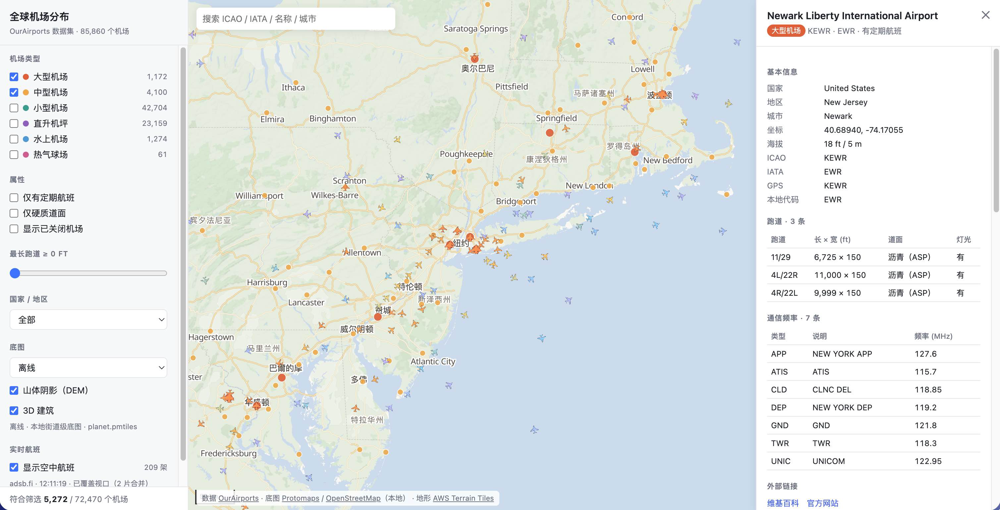

# Airports · 全球机场分布地图

一个**单文件、可离线、免安装**的网页地图，收录 [OurAirports](https://ourairports.com/)
全量 **85,860 个机场**（72,470 个在用 + 13,390 个已关闭）。按缩放级分级显示、
多维筛选、点选查看跑道与通信频率明细，美国机场还能直接在页面里翻 FAA 航图。

没有构建步骤，没有 npm，没有后端。克隆下来双击 `index.html` 就能用。



## 快速开始

    git clone https://github.com/flitai/Airports.git && cd Airports

然后二选一：

| 方式 | 底图 | 说明 |
|---|---|---|
| **双击 `index.html`** | Natural Earth（粗略）/ 在线 OpenFreeMap | 无需服务器，开箱即用 |
| **双击 `start.command`**（macOS）<br>**双击 `start.bat`**（Windows） | 追加本地街道级 PMTiles + 山体阴影 | 起 Range 服务器并开浏览器，需先[下载离线底图](OFFLINE.md) |

机场数据（`data/*.js`，16 MB）已随仓库提交，**第一种方式不需要任何额外下载**。
街道级瓦片是 100+ GB 的可选数据集，不在仓库里。

> ⚠️ 不要用 `python3 -m http.server` 起服务——它不支持 Range 请求，PMTiles 会失效
> （实测：发 `Range: bytes=100-199` 它返回 200 和整个文件）。项目自带的 `serve.py`
> 就是为此写的。

## 功能

- **分级显示** — z<4 仅大型机场 → z≥4 加中型与有定期航班的 → z≥7 加小型 → z≥10 加直升机坪/水上机场
- **筛选** — 类型、定期航班、硬质道面、最长跑道长度、国家、已关闭机场（按需加载）
- **搜索** — ICAO / IATA / 名称 / 城市
- **详情** — 跑道明细（道面归一 + 原始写法）、通信频率、坐标海拔、维基/官网外链
- **航图** — FAA d-TPP 覆盖的 2,397 个机场直接在页面内嵌查看，按综合/地面/离场/进场/进近分组；
  其余机场给 [ChartFox](https://chartfox.org/) 外链
- **底图** — 自动 / 在线 / 完全离线三档
- **山体阴影** — 本地 DEM（terrarium 编码），叠在道路之下
- **实时航班**（可选，需联网+服务器模式）— 按视口拉取空中航班，按航向旋转、按高度着色；
  点击飞机可查该呼号的历史航线并画出大圆航路；每架飞机身后拖一段渐隐的尾迹（可关）

## 底图的三种模式

侧栏「底图」可切换：

| 模式 | 说明 |
|---|---|
| **自动** | 有网走在线 OpenFreeMap；`navigator.onLine` 为假直接读本地，或在线 8 秒加载不出来自动切到本地 |
| **在线** | OpenFreeMap 矢量瓦片，需联网 |
| **离线**（默认） | **完全不联网**。按 `PMTILES_CANDIDATES` 预排顺序取第一个存在的本地包（planet → global-z9 → test-yrd），都没有才回落 Natural Earth 1:50m |

随仓库提供的 Natural Earth 底图（`data/basemap.js`，2.8 MB）含国界、湖泊、河流、
一级行政区界和 1212 个城市点，覆盖全球；文字字形内嵌在 `vendor/glyphs.js`，
所以断网时城市名和机场代码照样显示。但它是 1:50m 比例尺，z8 以上只剩海岸线和
国界——看全球分布够用，看单个机场周边环境要用在线或 PMTiles 底图。

装了 `planet.pmtiles` 后离线一档用的是手写的 `protomapsStyle()`，**60 层，比在线的
positron（55 层）还细**：七级道路分级带描边、跑道与滑行道、机场场区、水体/道路/
POI/地名分层标注。各地实测标注数量（离线 vs 在线）：弗吉尼亚 z10 是 13 : 14，
苏黎世 z12 是 85 : 57，上海 z15 是 139 : 16，巴黎 z13 是 132 : 33。

注意 `file://` 下浏览器禁止 `fetch`，探测不到本地瓦片，双击 `index.html` 时离线一档
只能是 Natural Earth——要用 PMTiles 必须走启动器。

## 实时航班（可选）

默认**关闭**。勾选侧栏「实时航班」后，按当前视口拉取空中的航班，图标按航向旋转、
按气压高度着色（低空暖色、高空冷色），悬停显示呼号/机型/注册号/高度/地速。

数据来自 [adsb.fi](https://adsb.fi/)，失败自动回退 [adsb.lol](https://adsb.lol/)，
两者都是社区众包的 ADS-B 聚合服务。

**视口覆盖**：上游单次查询的半径上限是 250 nm（实测 500 直接 400），所以视野一大
就盖不住整个窗口。代理端会按需把视口切成最多 4 个圆分别查询、按 ICAO24 去重合并；
再大就只覆盖中心区域，并在提示行明说「视口过大，放大可看全」，不假装全都拿到了。

**点击飞机看航线**：画成「起点 → 飞机 → 终点」两段大圆航路——飞过的一段是实线，
没飞的一段是虚线，折点跟着飞机走（球面插值，跨 180 度经线已解卷绕）。
面板列出航空公司、起降机场，两端可点进机场详情。机场按 ICAO 码在本地 8.6 万条库里
反查，所以名称与全站一致。

⚠️ 航线是**按呼号查历史记录**得来的，不是本架次提交的飞行计划——ADS-B 报文里根本
不含起降机场。同一呼号不同日期会飞不同城市对，实测 adsbdb 与 hexdb 对同一呼号能给出
两个矛盾答案。所以页面会拿飞机的实际位置做偏航校验：偏离该航路超过 200 nm 就明确
提示「这条多半不是今天这一班」。通航、包机、军机通常查不到任何记录。
航线数据来自 [adsbdb](https://www.adsbdb.com/)，回退 [hexdb.io](https://hexdb.io/)。

⚠️ **只在服务器模式下可用**。这两个数据源都不发 `Access-Control-Allow-Origin`
响应头，浏览器直连一律被同源策略拦下（`file://` 的 `null` 源和 `http://localhost`
都实测过），所以请求必须经 `serve.py` 转发——位置走 `/api/flights`，航线走 `/api/route`。
双击 `index.html` 时页面会自动禁用这个入口并说明原因。

这是个纯粹的联网增强项，**不勾选就一个请求都不发**，离线仍是这个项目的默认形态。
代理端对免费社区服务做了几重克制：同一视口 5 秒内复用缓存、轮询间隔 10 秒、
标签页切到后台就停、单片半径上限 250 nm 且最多切 4 片、连续 3 次失败自动关闭。
航线按呼号缓存 1 小时（查不到的也缓存，免得通航机反复打上游）。上游一条记录有
30+ 字段，代理只透传页面用得上的 10 个并压成定长数组。

## 本地接收机（可选）

默认**关闭**，需要一只 RTL-SDR 接收机。用 `python3 serve.py --sdr` 启动后，自己天线
收到的飞机会叠加到地图上：每秒更新一次，图标和尾迹是绿色的，以区别于联网数据。
它不依赖网络——断网时地图上照样有飞机，只是只有你天线看得见的那些。

```
brew install librtlsdr readsb uv     # macOS；驱动、ADS-B 解码器、Python 依赖管理
python3 serve.py --sdr               # 首次启动会自动装依赖，约一分钟
```

**与联网数据融合**：同一架飞机两边都有时只画一次，位置取更新的那一份（两个来源
各自带「位置时刻」）；注册号和机型只有联网数据有，本地报文不含，所以取到过就留着。
本地位置超过 15 秒没更新就让联网数据接手。

**接收机位置**：侧栏「设定接收机位置」后在地图上点一下，会画出 100 / 200 / 300 / 400 km
距离圈，以及按方位累计的**实测最远接收轮廓**——哪个方向被楼挡住了一目了然。
位置存在本机的 `.runtime/sdr.json`，不进仓库，`serve.py` 也拒绝对外提供这个目录。

**航空话音监听**：机场详情的频率表每行多一个「收听」按钮，点一下就听（118–137 MHz
的民航甚高频话音；导航台、短波这些收不了的行按钮置灰并写明原因）。

- 一只接收机一次只能看 1.92 MHz，而一个机场的频率常常跨好几兆赫。守护进程会把整张
  频率表分成几个**窗口**，在地图下方的频道条里按窗口分组列出，每个频道一个指示灯：
  亮 = 此刻有载波，空心 = 一直亮着不灭（持续播发的台，或者干扰），虚线 = 不在当前
  窗口。点别的窗口里的频道就切过去；开**轮巡**则在各窗口间循环，有人说话时停下来听。
- 频道名按 ICAO 的 8.33 kHz 约定换算成真实载波（`118.005` 的载波在 118.000，
  `118.010` 在 118.00833）。
- **自动频率跟踪**：实际载波可以偏离标称值好几千赫——偏置载波系统的各支载波分别偏
  ±5 或 ±7.3 kHz，便宜接收机的晶振也有误差——不用手工校准。
- **无话音时静音**（默认开）：只有载波、没有人说话时不出声。室内常能收到电脑、电源、
  网口时钟的杂散，它们是不带调制的载波，解调出来只有噪声。关掉这一项则有载波就放。
- 静噪门限是载噪比（载波比信道带宽内的噪声高多少 dB），默认 7 dB。
- 话音和 ADS-B 不在一个频段，一只接收机不能同时收：进话音时本地 ADS-B 暂停（联网
  航班不受影响），状态条末尾有一键返回；所有窗口都没开声音时倒计时一分钟自动返回。
- 浏览器不允许页面未经操作就出声，所以刷新页面后要点一下频道条上的「开启声音」。

**频谱与瀑布图**：地图下方的停靠栏有三档——收起、半高、展开（按 `W` 循环，或点标题行
右侧的三个小按钮）。上半是频谱曲线，下半是瀑布图，最新的一行在最上面，每秒约 12 行，
一屏看到接收机眼下这 1.92 MHz 里有什么。

- 话音模式下默认半高。当前窗口里的每个频道在图上有一条线和名字，正在听的那个画出
  信道带宽和实际载波的位置。**点瀑布图上的任何一处就调过去听**：点在频率表里的频道上
  是切频道，点在别处则生成一个手动频道（频道条上标着「手动」，点它右边的 × 删除）。
  滚轮以鼠标位置为中心放大（最多 8 倍）。
- 标题行的**频率框**可以直接敲一个 118–137 MHz 的频率或频道名回车，不必在任何机场的
  频率表里，从 ADS-B 模式也能直接进话音。
- 右侧的**信号列表**列出窗口里强到能开静噪的载波，不管它在不在频率表里：频率、
  载噪比、此刻是否在发射、已经持续了多久（一直在的多半是通播或者干扰）。表里没有的，
  如果设了接收机位置，会拿周围 250 海里内各机场的频率表去对，写成「可能是 ZBAA APP ·
  23 km」——只是可能：同一个频率会被相隔几百公里的机场重复使用。换窗口后之前见过的
  信号仍留在列表里。点一行就听。
- ADS-B 模式下也能打开（默认收起），看的是 1090 MHz 附近，只看不调。没有窗口开着
  瀑布图时，守护进程在 ADS-B 模式下不为它做任何计算。
- 窗口正中那条虚线是接收机自身的直流毛刺，不是信号；频道划分时已经让各频道避开它。

**话音触发录音**：勾上停靠栏标题行的「录音」，被收听的频道上一有人说话就自动存一段，
一次通话一个文件。

- 触发看的是话音，不是载波：室内那些没有调制的干扰载波亮多久都不会录。开录时带上
  此前半秒，所以一句话的头不会被切掉；静噪关闭即结束。
- 存的是解调好的 16 kHz 单声道 WAV（每秒 32 KB），旁边一份同名 JSON 写明频道、机场、
  UTC 时刻、时长、载噪比、载波偏差。文件在 `.runtime/recordings/`，文件名是 UTC 时刻
  加频率，例如 `20261118T122816Z_121.900.wav`。
- 一段最长 60 秒。通播这类连续播发的台只录一段，那次发射不结束就不再触发，所以开着
  录音走开，磁盘也不会被写满。目录总大小另有上限（默认 200 MB，约 100 分钟，
  `.runtime/sdr.json` 里的 `rec_quota_mb`），超了从最旧的删起。
- 录音是守护进程自己的事，不需要有页面开着声音，页面关掉也照录。开着录音时接收机
  不会倒计时返回 ADS-B；配合**轮巡**可以无人值守地录一个机场的各个频道。
- 停靠栏右侧的「录音」页列出片段，点一下回放（回放时现场的声音自动让开），可单段删除
  或清空。ADS-B 模式下打开停靠栏也能翻。
- 只录正在收听的那一个频道，同窗口里别的频道不录。要把整个窗口留下来，用下面的 I/Q。

**原始 I/Q 的录制与回放**：把接收机当时看到的整个窗口（2.4 MS/s 的 8 位采样）原样存下来，
之后在界面里回放——换着听窗口里的每一个频道、调静噪、反复看同一段瀑布图。

- **立即录**：停靠栏标题行的「立即录 I/Q」按钮，按下就开录，不等人说话；再按停止，最长
  60 秒（`iq_max_s`）。守护进程一直留着最近 1.5 秒的采样，开录时放在最前面：等反应过来
  去按，想录的那一下往往已经过去了。话音和 ADS-B 两种模式下都能录。
- **有人说话时自动录**：勾上「录 I/Q」，每次通话自动存那一段的整窗 I/Q。它和「录音」用
  同一个触发，但各管各的，可以只开一个；两个都开时，话音片段的 JSON 里记着对应的 I/Q
  文件名。被当成噪声的那一下，I/Q 也不留。
- 每秒 4.8 MB，一分钟 288 MB。所以单独存放、单独算配额：`.runtime/iq/`，默认上限
  2 GB（`iq_quota_mb`），超了从最旧的删起。文件是 `rtl_sdr` 那种 `.cu8`，旁边一份 JSON
  记着中心频率、增益、当时的频道表。写盘跟不上时丢块并记数，不拖累接收。
- **回放**：停靠栏右侧「I/Q」页里点一段。接收机换成这段录制，循环播放；状态条的圆点
  变成紫色并写明「回放」，真接收机在此期间释放。瀑布图、点击调谐、收听、话音录音都
  照常可用。调到别的窗口时，录下来的频谱按频点平移过去，录制范围以外是空的——当时
  接收机没看着的地方，回放里也没有。点「返回实时」回到回放之前的模式；页面全关掉
  一分钟后也会自己回去。
- 命令行里也能直接放：`SDR_SOURCE=file:<路径> python3 serve.py --sdr`（这种方式不知道
  录制时的中心频率，只适合 ADS-B 的录制）。

**地图上方的状态条**随时说明接收机在做什么、收得怎么样；没插上、被别的程序占用、
缺驱动这类问题也只在那里提示，并说明怎么处理。取消勾选会**真正释放设备**，
别的 SDR 软件可以接着用。

**结构**：接收机由一个独立的守护进程 `sdr/sdrd` 独占，页面通过 WebSocket 与它通信；
`serve.py` 只负责把它拉起来、告诉页面端口，自己仍然只用标准库。守护进程把原始采样
经管道喂给 [readsb](https://github.com/wiedehopf/readsb) 解码。整条进程链靠管道
跟随父进程的生死：`serve.py` 哪怕被 `kill -9`，守护进程和解码器也会在几秒内自行退出，
不会留下占着 USB 的孤儿进程。守护进程只监听本机，并校验页面来源，别的网站连不上。

**型号**：界面显示的型号以驱动的认定为准。RTL-SDR Blog V4 靠 USB 字符串
`RTLSDRBlog / Blog V4` 识别；报 `Realtek / RTL2838UHIDIR` 的是 V3 或通用型号，
可调谐范围是 24–1766 MHz。ADS-B 在哪种型号上都一样能收。

不插接收机也能看效果：`SDR_SOURCE=synth:adsb:纬度,经度 python3 serve.py --sdr`
会用合成信号造三架绕该点转圈的假飞机，走的是和真机完全相同的解码链路。后面再加
`;air:118.5,121.9~2/5` 这样的一段，就多出几个合成的话音台（写法见
`sdr/sdrd/synth.py` 的 `Station.parse`）。

键盘（在输入框里打字时不生效）：`1` 接收 ADS-B，`2` 回到话音监听，`0` 关闭并释放设备，
`W` 切换瀑布图的三档（展开时 `Esc` 先收回半高）；话音模式下空格静音，左右方向键按
25 kHz 步进调谐（按住 Shift 为 8.33 kHz；焦点在地图上时方向键归地图）。

目前做了 ADS-B（1090 MHz）、航空话音监听、频谱与瀑布图、话音触发录音、原始 I/Q 的
录制与回放。VDL2 数据链、全波段扫描在后续版本。

验证：`sdr/.venv/bin/python -m unittest discover -s sdr/tests`（不需要接收机），以及
`sdr/tests/browser/run.sh`（用无头 Chrome 和合成信号走完整链路）。

⚠️ 接收 ADS-B 广播在多数地区是允许的，但**监听和录制其他无线电通信在部分国家和地区
受法律限制**，转述、传播通信内容的限制往往更严，使用前请了解当地规定。

## 桌面外壳（可选）

想要一个独立窗口、不想开终端和浏览器的话，`desktop/` 里有一个 Electron 外壳：

```
cd desktop
npm install        # 首次
npm start          # 带接收机；不用接收机则 npm start -- --no-sdr
```

Electron 本体不随 `npm install` 下载，而是在第一次 `npm start` 时才取：压缩包 121 MB，
解开后占 258 MB。从 GitHub 下载慢的话可以换镜像，安装脚本照常核对 SHA-256：

```
ELECTRON_MIRROR=https://npmmirror.com/mirrors/electron/ npm start
```

它很薄：拉起 `serve.py`、开一个窗口加载同一个页面、退出时把所有子进程带走，
此外什么都不做。页面与浏览器里看到的完全一样，菜单里的接收机命令也只是向页面
派发事件。关掉窗口即退出并释放接收机，不会留在程序坞里继续占着设备。

外壳被强制结束时，`serve.py`、接收机守护进程和解码器同样会在几秒内自行退出。

**打成应用**（macOS）：`sh desktop/build-app.sh`（或在 `desktop/` 里 `npm run package`），
产物是 `desktop/dist/Airports.app` 和一个 zip。它直接改装 `node_modules` 里那份
Electron，不用再联网下载。打出来的仍是薄壳，不是自带一切的应用：

- 目标机器上要有 `python3`；用本地接收机还要 `uv`、`librtlsdr`、`readsb`。
- 离线瓦片不在包里。启动后在菜单「底图 → 选择离线瓦片目录…」里指到放着
  `planet.pmtiles` 的目录；不选的话离线底图是内置的 Natural Earth 简图。
- 设置、接收机的运行期状态和 Python 依赖都放在
  `~/Library/Application Support/Airports`，应用不往自己的包里写这些。
  例外是 FAA 航图索引：过期后的自动更新仍会改写包里的 `data/faa.js`。
- 没有开发者签名。在打包的这台机器上可直接打开；拷到别的 Mac 上，系统会因
  「无法验证开发者」拦一次，右键 → 打开即可。

## 项目结构

```
index.html                单页应用（HTML+CSS+JS 全内联，90 KB）
serve.py                  Range 静态服务器 + /api/flights、/api/route 代理，一个进程全包
sdr/                      可选的本地接收机：sdrd 守护进程、界面（按需加载）、测试
desktop/                  可选的 Electron 桌面外壳（main.js 一个文件）
start.command             macOS 双击启动器    start.bat  Windows 双击启动器
data/                     机场数据 + FAA 航图索引（.js 格式，file:// 下也能加载）
vendor/                   maplibre-gl.js · pmtiles.js · glyphs.js（内嵌拉丁字形）
tiles/                    可选的离线瓦片，不在仓库里（见 OFFLINE.md）
build_*.py                数据编译脚本
fetch_*.py                按需下载部分矢量底图（见 TILES.md）
download_offline_maps.py  整份拉全球底图与高程（见 OFFLINE.md）
```

数据输出为 `.js`（`window.X = JSON.parse('...')`）而非 `.json`，因为 `fetch`/XHR
在 `file://` 下被浏览器阻止，而经典 `<script src>` 标签不受限——这是"双击打开"
能成立的前提。同理，离线底图也编译成 `.js` 而不用 PMTiles/MBTiles。

中日韩地名不靠字形服务器，用 MapLibre 的 `localIdeographFontFamily` 交给系统字体
在客户端渲染；本地只内嵌了拉丁字形（Noto Sans Regular 0-255，100 KB）。

## 离线底图（可选）

想在完全断网时看到街道级底图，有两条路：

| 文档 | 脚本 | 适合 |
|---|---|---|
| **[OFFLINE.md](OFFLINE.md)** | `download_offline_maps.py` | 整份拉全球 z0-15（128 GB）+ 全球高程（6.9 GB）。自包含，只依赖 Python 标准库 |
| **[TILES.md](TILES.md)** | `fetch_tiles.py` / `fetch_levels.py` | 只要部分区域或部分缩放级。基于 `pmtiles extract` 按需抓取，需要 pmtiles CLI |

全球累计体积（实测，build 20260817）：z0-12 **17.6 GB** · z0-13 **35.6 GB** ·
z0-14 **67.6 GB** · z0-15 **128 GB**。z12 够看清城市路网，z14 能看清单条跑道和滑行道。

## 重新生成数据

    python3 build_data.py                    # 读同目录 CSV，输出 data/*.js
    python3 build_basemap.py <NE_geojson目录>  # 重新编译离线底图
    python3 build_faa.py                     # 下载 FAA 航图索引，输出 data/faa.js

`data/*.js` 已随仓库提交，克隆下来直接就能打开页面。只有要重新编译时才需要 CSV
原始数据——它们体积大、上游每日更新，故不入 git，用下面这行拉到项目根目录：

    for f in airports airport-comments airport-frequencies runways navaids countries regions; do \
      curl -O "https://davidmegginson.github.io/ourairports-data/$f.csv"; done

`build_data.py` 负责：道面材质归一（565 种原始写法 → 9 类）、按机场聚合跑道与频率、
拆分已关闭机场、字典编码国家/地区、预计算 zoom 分级用的 rank。

`build_faa.py` 需要联网，自动探测当前生效的 AIRAC 周期。航图数据每 28 天换一版，
FAA 只把最近三个周期留在服务器上，过期的 PDF 会 404。

**这件事已经自动化了**：用 `start.command` / `start.bat` 启动时，`serve.py` 会读
`data/faa.js` 里存的周期截止日，过期就在后台重跑 `build_faa.py`（约 2 分钟，下载
16 MB 元数据）。服务器不等它，立即就能用；更新完成后控制台会提示刷新页面。
写文件是「先写 `.tmp` 再原子改名」，所以后台更新不会让正在加载的页面读到半截数据。

没联网、超时、脚本报错都只打印警告，不影响启动——页面会照旧在航图区提示可能失效。
加 `--no-update` 可跳过这项检查。

⚠️ 双击 `index.html` 的 `file://` 模式下没有 Python 进程，**无法自动更新**，
只能靠页面提示后手动重跑 `build_faa.py`。

**副作用**：`data/faa.js` 是随仓库提交的，而自动更新会就地改写它。所以每换一个
AIRAC 周期，`git status` 就会冒出一条 `M data/faa.js`——这不是你改的，是服务器
自己刷的。提交它即可（让仓库里的索引保持新鲜），或者 `git checkout data/faa.js`
丢掉、下次启动再刷。两种都行，别当成脏工作区去查。

## 已知限制

- Web Mercator 在 ±85.05° 外不可表示，2 个南极点位（含 NZSP 南极点站）被钳制到
  地图边缘渲染，详情面板显示的仍是真实坐标。
- 跑道两端坐标仅 32% 的记录有，因此未绘制跑道几何线，只在详情面板列表格。
- 内嵌航图只覆盖 FAA d-TPP（2,397 个机场）。其他国家的 AIP 要么需要登录，要么带
  `X-Frame-Options` 禁止跨源内嵌（ChartFox 就是 `SAMEORIGIN`），只能跳外链。
- 看航图需要联网，`file://` 双击模式下也一样——本地只有索引，PDF 在 FAA 服务器上。
- `airport-comments.csv`（16,365 条社区评论）与 `navaids.csv` 本版未使用。
- 在线底图看过的瓦片会进浏览器 HTTP 磁盘缓存，同一区域断网也能显示；但换区域或
  缩放级就是空白，且缓存会被回收。要可靠离线请用离线底图模式。

## 数据来源

- 机场数据 [OurAirports](https://ourairports.com/)（公共领域）
- 离线底图 [Natural Earth](https://www.naturalearthdata.com/) 1:50m（公共领域），
  取自 [nvkelso/natural-earth-vector](https://github.com/nvkelso/natural-earth-vector)
- 在线底图 [OpenFreeMap](https://openfreemap.org/) / [OpenStreetMap](https://www.openstreetmap.org/copyright)
- 矢量瓦片 [Protomaps](https://protomaps.com/)（OpenStreetMap 数据，ODbL）
- 航图 [FAA d-TPP](https://www.faa.gov/air_traffic/flight_info/aeronav/digital_products/dtpp/)（公共领域，
  覆盖美国及其属地、密克罗尼西亚/马绍尔/帕劳）；其余机场外链 [ChartFox](https://chartfox.org/)（需 VATSIM 账号）。
  **仅供仿真使用，真实飞行请用官方现行有效版本。**
- 实时航班 [adsb.fi](https://adsb.fi/) / [adsb.lol](https://adsb.lol/)（社区众包 ADS-B）
- 航线查询 [adsbdb](https://www.adsbdb.com/) / [hexdb.io](https://hexdb.io/)
- 本地接收（可选）：驱动 [librtlsdr](https://osmocom.org/projects/rtl-sdr/wiki)（GPL-2.0+）、
  解码 [readsb](https://github.com/wiedehopf/readsb)（GPL-3.0+），均需自行安装，不随仓库分发；
  设备层与部分算法移植自 SDR Lab，见 [sdr/NOTICE.md](sdr/NOTICE.md)
- 地图引擎 [MapLibre GL JS](https://maplibre.org/) 5.6.1（BSD-3）
- 字形 Noto Sans Regular（SIL OFL）

## 许可证

Copyright (C) 2026 FlitAI

本项目以 **GNU General Public License v3.0** 授权，完整条款见 [LICENSE](LICENSE)。

这意味着你可以自由使用、修改和分发本项目，但**任何分发出去的衍生作品必须同样
以 GPL-3.0 开源**，并附带源码。

`vendor/` 下的第三方组件（MapLibre GL JS、PMTiles JS、Noto Sans 字形）不受此
许可证约束，各自沿用 BSD-3-Clause / SIL OFL；`data/` 下的数据来自公共领域数据集。
详见 **[THIRD-PARTY-NOTICES.md](THIRD-PARTY-NOTICES.md)**。
